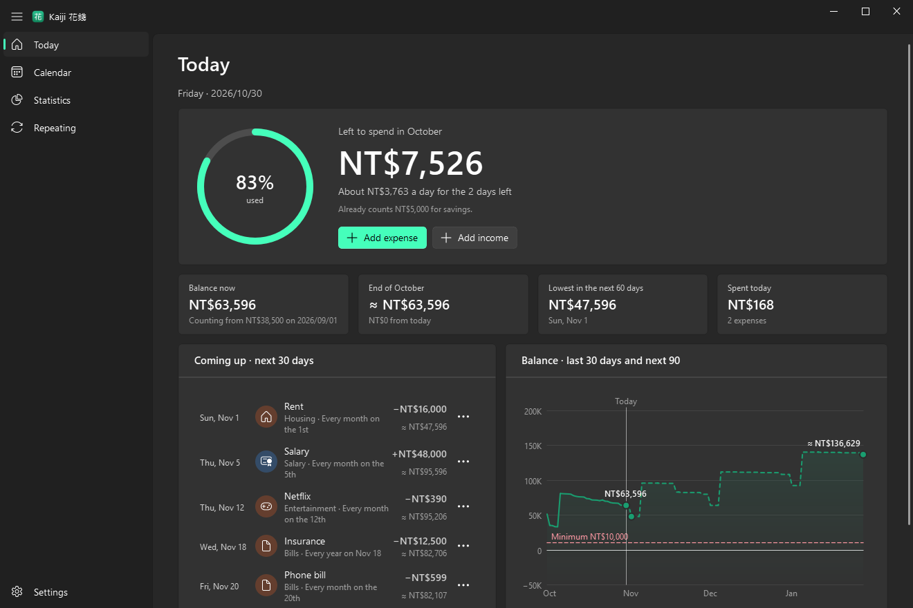
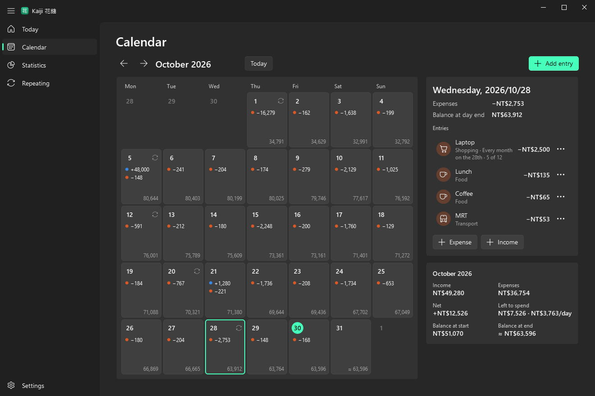
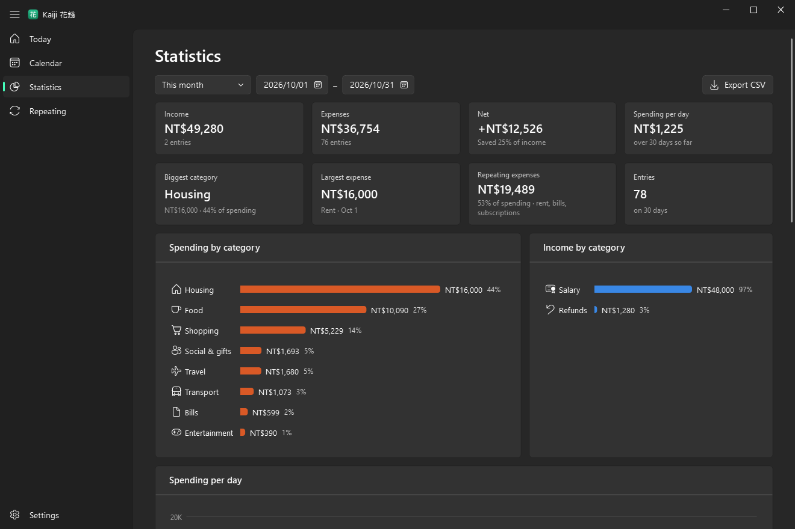
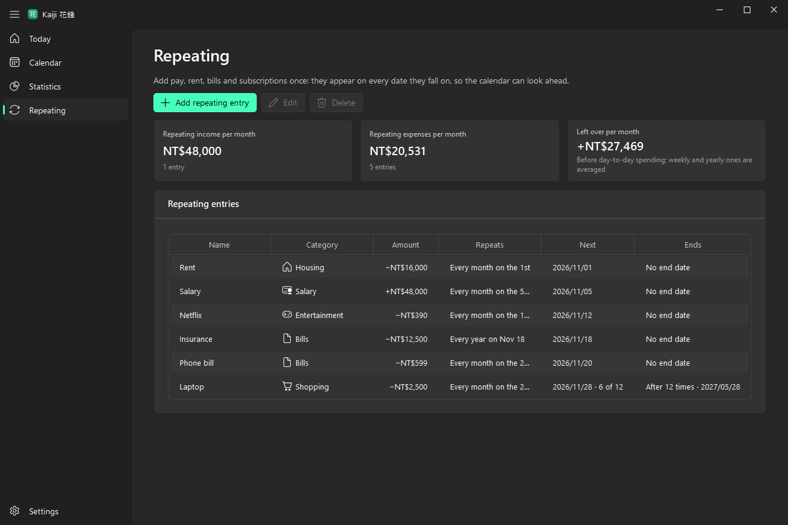
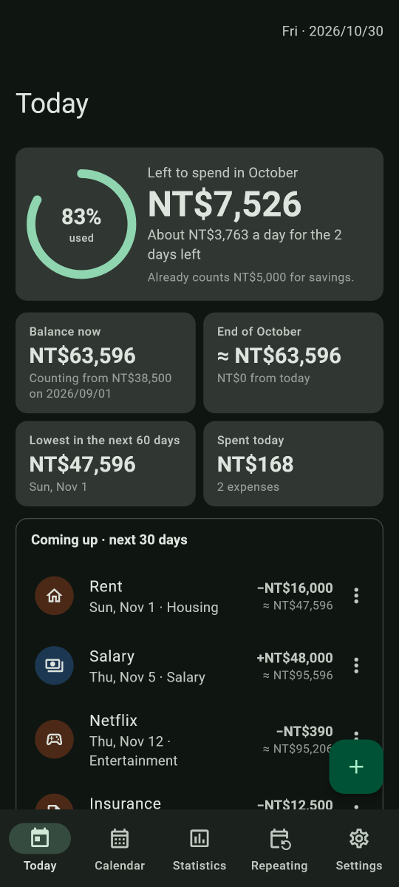
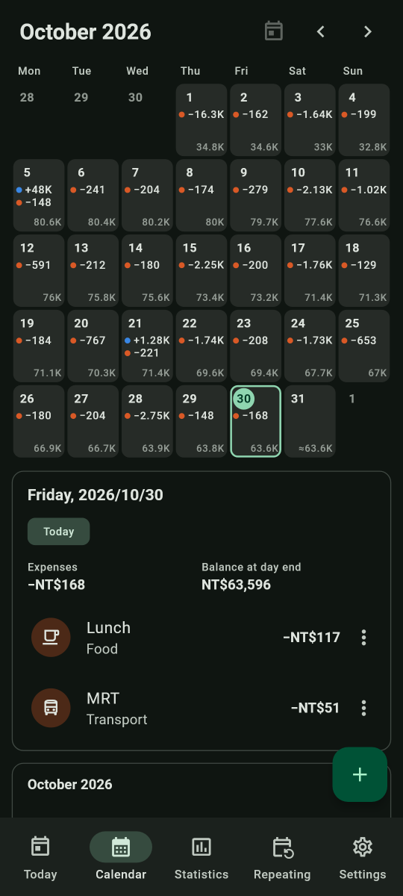
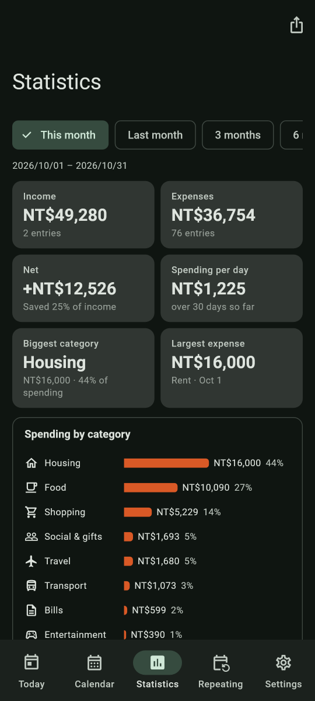

# Kaiji 花錢


A monthly spending tracker for Windows 10/11 and Android. Put your income and spending on a calendar, including what's still to come like pay day and rent, and Kaiji shows what your balance will be on any day and how much you can still spend this month.
No account and no cloud: your data stays on your own devices, and they can sync through your own PostgreSQL server if you like.



## Features

- 💰 **Left to spend** – How much you can still spend this month, and about how much a day, after the bills still to come and your savings goal.
- 📅 **A calendar that looks ahead** – Every day's income, spending and end-of-day balance, projected (≈) for the days ahead and red when it would drop below your minimum.
- 🔁 **Repeating entries** – Pay, rent, bills and subscriptions, added once: daily, weekly, monthly or yearly, ending never, on a date or after a number of times.
- 📊 **Statistics** – Spending and income by category, per day and per month, and the balance, for any range. Every entry in a table, with CSV export.
- 🧮 **Amounts do the math** – Type `120+35`, `3*45`, `1.5k` or `3萬`.
- 📱 **On your phone too** – Kaiji for Android has the same pages and the same database, so a backup made on either opens on the other.
- 🔄 **Sync between devices** – Optional, through a PostgreSQL server on your network. Each device keeps working without it.
- 💾 **Backups** – Back up and restore in Settings. The PC also keeps a copy for each of the last 10 days you used it.
- 🎨 **Fluent and Material You** – Windows 11's look on the PC (Mica, your accent color), your wallpaper's colors on Android 12 and later, light and dark on both.
- 🔒 **Yours only** – No account, no ads, no tracking. Kaiji only goes online to sync, and only with your server.

## Screenshots

The calendar shows each day's spending and the balance at its end, projected (≈) for the days ahead:



| 📊 Statistics | 🔁 Repeating |
| --- | --- |
|  |  |

On the phone:

| 💰 Today | 📅 Calendar | 📊 Statistics |
| --- | --- | --- |
|  |  |  |

The screenshots are in dark mode; Kaiji follows your light or dark setting, or you can pick one in Settings. The household in them is made up.

## Quick start

1. Get Kaiji running:
   - **PC:** build it with `.\build.ps1` and start `dist\Kaiji\Kaiji.exe` (see [Build](#build)), or [run it from source](#run-from-source).
   - **Phone:** build it with `.\build.ps1 android`, copy `dist\Kaiji-release.apk` to your phone and open it (Android asks you to allow installing apps from where you opened it), or install it over USB with `flutter install`.
2. The first time, a short setup asks for:
   - your **currency**;
   - the **money you have today**, all your accounts together (Kaiji works out every other day's balance from it);
   - your **monthly pay** and its day (optional);
   - a **savings goal** per month (optional).

   Everything can be changed later in **Settings**, and **Run setup again** at the bottom of Settings opens the setup again.
3. Add what repeats on the **Repeating** page: rent, bills, subscriptions, installments. They appear on every date they fall on, so the calendar can look ahead.
4. Add your spending as it happens: **Add expense** on Today (**Ctrl+N** anywhere on the PC, **+** on the phone).
5. Check **Today** for what's left to spend this month. 🎉

On the PC, the calendar takes the keyboard: the arrow keys move between days, Page Up/Down between months, Home goes to today and Enter (or a double-click) adds an entry. Right-click an entry, or click its **⋯** button, for everything else you can do with it. On the phone, long-press it or tap **⋯**.

## Left to spend

**Settings → Your plan → Left to spend comes from** picks how it's worked out:

| You want | Choose | Left to spend is |
| --- | --- | --- |
| A monthly budget from your pay | **This month's income** (the default) | the month's income − its expenses (recorded and still to come) − your savings goal. It's never more than would take your balance below your minimum on any day until the month ends; when that's what limits it, Today says so. |
| To spend from everything you have | **Everything I have** | the lowest balance between today and the month's end − your minimum. |

Spend about the daily amount and the daily amount stays the same; spend more and it drops for the rest of the month.

The rest of the plan is in the same place. The **starting balance** is what you had at the start of a day, all accounts together; every other day's balance is worked out from it, and without one balances simply add up from your first entry. **Keep at least** is your minimum: Kaiji warns you when your balance is heading below it and never counts it as money to spend.

## Repeating entries

A repeating entry falls on every date it repeats: daily, weekly, monthly or yearly, every N of those. One on the 31st falls on the last day of shorter months. It ends never, on a date, or after a number of times (12 monthly installments, say). A skipped date still counts toward that number, so the plan doesn't grow, and each date shows where it is ("5 of 12").

On a date in the calendar (right-click, the **⋯** button, or a long-press on the phone):

- **Edit this date only** – only that date changes.
- **Edit this and later dates** – a raise or new rent: the old one ends the day before and the new one carries on, with the dates the old one skipped.
- **Edit all dates**, **Skip this date**, **Stop after this date** and **Delete all dates**.

Deletes and skips can be undone from the notice that appears. ↩️

## Sync between your PC and phone

Kaiji works on its own on each device. If you have a PostgreSQL server on your network (12 or later; tested with 17), the PC and the phone can also share their data through it. Each keeps its own database and keeps working when the server can't be reached; changes go across when it can, a couple of seconds after you make them and every minute while Kaiji is open.

### The server, once

Kaiji gets a login and a database of its own, so it can't see or change anything else on the server. As the server's admin (in `psql -U postgres`, say):

```sql
CREATE ROLE kaiji LOGIN;
\password kaiji
CREATE DATABASE kaiji OWNER kaiji;
REVOKE ALL ON DATABASE kaiji FROM PUBLIC;
```

`\password` asks for the password, so it doesn't end up in psql's history or the server's log.

Then the devices on your network need to be let in. Many servers already let password logins in from anywhere (the official Docker image does, with `host all all all scram-sha-256` in `pg_hba.conf`); if yours doesn't, add a line to `pg_hba.conf`, above any line that would match them first, and reload the server (`SELECT pg_reload_conf();`):

```text
# TYPE   DATABASE  USER   ADDRESS          METHOD
hostssl  kaiji     kaiji  192.168.1.0/24   scram-sha-256
```

If the server has no TLS set up, use `host` instead of `hostssl`, and turn off **Encrypted connection** in Kaiji. Kaiji makes its tables itself, in a `kaiji` schema, the first time it connects.

<details markdown="1">
<summary>On Home Assistant, with the Postgres 17 app</summary>

The [Postgres 17 app](https://github.com/alexbelgium/hassio-addons/tree/master/postgres_17) runs the official PostgreSQL image in a container called `app_db21ed7f_postgres_latest`. Open `psql` inside it to run the SQL above:

- **Portainer:** Containers → `app_db21ed7f_postgres_latest` → **Console**, with `/bin/bash` as `root`, then `psql -U postgres`.
- **A terminal that has `docker`** (the Advanced SSH & Web Terminal app, with Protection mode off): `docker exec -it app_db21ed7f_postgres_latest psql -U postgres`.

Inside the container, `psql` doesn't ask for a password. If you set `POSTGRES_USER` in the app's options, use that name instead of `postgres`.

`pg_hba.conf` needs no new line: the image already lets password logins in from anywhere, and your other apps likely rely on that, so leave the file as it is. To see for yourself, run `grep -v '^#' /config/database/pg_hba.conf | grep .` in the container's console.

The app runs without TLS, so turn off **Encrypted connection** in Kaiji. To keep it on instead, make a certificate in the container's console (as `root`), then restart the app once. Your other apps lose their connection for a moment, and those that don't use TLS carry on as before.

```bash
cd /config/database
openssl req -new -x509 -days 3650 -nodes -subj "/CN=homeassistant" -out server.crt -keyout server.key
chown postgres:postgres server.crt server.key && chmod 600 server.key
echo "ssl = on" >> /config/postgresql.conf
```

Kaiji's database then goes into your Home Assistant backups along with the app's other data.

</details>

### Connecting

**Settings → Sync with PostgreSQL**, on the PC and on the phone: the server's address, the port (5432), the database and user (`kaiji`) and the password.

- The first device to connect puts its data on the server, so connect the one with your up-to-date data first.
- A device with no entries of its own takes the server's data. One that has entries asks which to keep: the server's (the PC keeps a copy of its own in the backups folder; the phone offers **Undo**) or its own (the server's data is replaced, and your other devices get it when they next sync). Kaiji doesn't merge the two: they're usually copies of each other from earlier backups, and would double up.
- Restoring a backup while syncing replaces the server's data too: the backup becomes everyone's data.
- When the same entry is changed on two devices before they sync, the change that reaches the server last wins.
- The phone syncs while Kaiji is open and once more as you leave it; nothing runs in the background. Where the server can't be reached (away from home, unless you have a VPN), changes wait and go up when it can.
- To sync right away, click **Sync now** at the bottom of the navigation pane (or press F5) on the PC, or pull any page down on the phone.
- **Turn off** leaves the data on the device and on the server as it is.

The password is kept in Windows Credential Manager on the PC and in the Android Keystore on the phone, never in Kaiji's database, its settings file or a backup. Android's own backup leaves it out too, so a restored phone asks for it again.

<details markdown="1">
<summary>How sync works</summary>

Every category, entry and repeating entry has a random `uid` that's the same on every device, next to the local id the rest of the app uses. SQLite triggers note each change in a `sync_changes` table. The triggers live in the database file and are the same in both apps, so none of the code that changes your data had to know about sync.

A round sends what's noted, then fetches what other devices sent since the last round. On the server, each row keeps the version it was last written at (from one sequence) and a deleted flag, so "since the last round" is "version > the last version this device saw". Devices take turns writing (an advisory lock), so versions are committed in order, and a device reads all tables from one snapshot, so it can't skip past a row it didn't see. Something you change while a round is under way is left alone, and goes up in the next round.

The server's side is in [sync.py](Kaiji.Windows/kaiji_app/sync.py) and [sync.dart](Kaiji.Mobile/lib/src/sync.dart); the triggers are in `store.py` and `store.dart`.

</details>

## Limitations

- One currency at a time: amounts in other currencies have to be converted by hand.
- Entries are typed in. There's no import from banks, cards or CSV files.
- Sync keeps one device's data or the server's when a device first connects, never a merge of both. When two devices change the same entry before they sync, the last one to reach the server wins.
- The phone only syncs while Kaiji is open (and once as you leave it), and only where it can reach the server.
- Not on the phone yet: the entries table in Statistics, and the PC's automatic daily backups (Android's own backup includes Kaiji's data instead).
- Kaiji for Windows needs Windows 10 or 11, and Kaiji for Android needs Android 7.0 or later. There's no iPhone version.

## To do

- [x] Kaiji for Android
- [x] Sync between devices through PostgreSQL
- [ ] The entries table in Statistics on the phone
- [ ] Automatic daily backups on the phone
- [ ] Release builds: an installer for Windows and a signed APK

## Where your stuff lives

Everything stays on your own devices, and on your server if you sync. The PC and the phone keep the same database file, so a backup from either opens on the other.

| What | PC | Phone |
| --- | --- | --- |
| Your money: entries, repeating entries, categories, plan and currency | `%APPDATA%\Kaiji\kaiji.db` | `kaiji.db` in Kaiji's private storage |
| Automatic backups | `%APPDATA%\Kaiji\backups\`: one for each of the last 10 days Kaiji ran, and one before every restore or before taking the server's data | – (Android's own backup includes Kaiji's data) |
| Settings: theme, accent color, first day of the week, where to sync | `%APPDATA%\Kaiji\config.json` | Kaiji's app preferences |
| The sync password | Windows Credential Manager, as `Kaiji/PostgreSQL` | the Android Keystore |

**Settings → Your data → Open folder** opens the PC's folder. Theme, first day of the week and wallpaper colors belong to each device and aren't part of a backup.

**Moving your data without sync:**

- **Phone → PC:** on the phone, **Settings → Back up** shares a `.db` file (Drive, email, Nearby Share…). On the PC, **Settings → Restore** and pick it.
- **PC → phone:** on the PC, **Settings → Back up** (or copy `%APPDATA%\Kaiji\kaiji.db`). Get the file onto the phone, then **Settings → Restore**.

A restore replaces everything on that device. The PC keeps a copy of what was there in the backups folder first; on the phone, **Undo** on the notice that follows puts it back.

## Updating

Your data, backups and settings aren't in the program's files, so an update keeps them. 🔄

- **PC, built exe:** close Kaiji, then replace the `Kaiji` folder's `Kaiji.exe` and `_internal\` with the new build's. Delete the old `_internal\` instead of copying over it, so no files from the old version stay mixed in.
- **PC, from source:** `git pull`, then run `pip install -r Kaiji.Windows\requirements.txt` again in case something new is needed.
- **Phone:** install the new APK over the old one. Android keeps Kaiji's data.

The APK is signed with the debug key of the PC that built it (`%USERPROFILE%\.android\debug.keystore`), and Android only updates an app with an APK signed with the same key. An APK built on another PC can't update it (Android says the app wasn't installed). Back up on the phone first, uninstall Kaiji, install the new APK and restore the backup, or let it take the server's data. To build on more than one PC, copy that `debug.keystore` between them.

## Uninstalling

- **PC:** delete the `Kaiji` folder (the built exe) or the repository (running from source). Your data stays in `%APPDATA%\Kaiji` until you delete that folder too. If sync is on, turn it off first so the saved password goes as well, or remove `Kaiji/PostgreSQL` from Windows Credential Manager.
- **Phone:** uninstall Kaiji in Android's settings. That deletes its data and the saved password, so back up first if you want to keep them.
- **Server:** `DROP DATABASE kaiji; DROP ROLE kaiji;` as the server's admin removes Kaiji from it.

## Offline and privacy

Kaiji has no account, no ads and no tracking. It only goes online to sync, and only with the server you set up:

- **On the PC**, nothing connects anywhere while sync is off; the PostgreSQL driver isn't even loaded.
- **On the phone**, the Internet permission is only there for sync.
- **Backups and CSV exports** go only where you send them.

## Run from source

### PC

You need Python 3 (64-bit; Kaiji is developed with 3.12).

```powershell
git clone https://github.com/EnderDragonEP/KaiJi
cd KaiJi
pip install -r Kaiji.Windows\requirements.txt
pythonw Kaiji.Windows\Kaiji.pyw      # or double-click Kaiji.pyw
```

<details markdown="1">
<summary>About requirements.txt</summary>

- **PySide6** and **PySide6-Fluent-Widgets** are the app. Kaiji uses PySide6 only: PyQt6 and PySide6 are two separate bindings of the same Qt and one process can't mix them, and PySide6-Fluent-Widgets is built on PySide6.
- **psycopg** (with its own libpq, `psycopg[binary]`) talks to PostgreSQL. It's only loaded once sync is on.

</details>

### Phone

You need Flutter 3.47 or later and the Android SDK (Android Studio's works).

```powershell
cd Kaiji.Mobile
flutter pub get
flutter run       # a debug build with hot reload, on a plugged-in phone or an emulator
```

[Kaiji.Mobile/README.md](Kaiji.Mobile/README.md) has more about the phone app.

## Build

```powershell
.\build.ps1             # dist\Kaiji\Kaiji.exe
.\build.ps1 android     # dist\Kaiji-release.apk
.\build.ps1 all         # both
```

| Command | Builds | Needs |
| --- | --- | --- |
| `.\build.ps1 [args]` | `dist\Kaiji\Kaiji.exe` with PyInstaller (with `_internal\`, about 135 MB). Extra arguments go to PyInstaller, e.g. `.\build.ps1 --clean`. | `pip install pyinstaller` |
| `.\build.ps1 android [args]` | `dist\Kaiji-release.apk`, about 55 MB with the code for every kind of phone. Extra arguments go to `flutter build apk`: `.\build.ps1 android --split-per-abi` makes one APK per kind instead, about 20 MB each (most phones take the `arm64-v8a` one). | Flutter and the Android SDK. Flutter from PATH, or from `%USERPROFILE%\flutter`. |
| `.\build.ps1 all` | Both. | Both. |

If PowerShell refuses to run the script because of the execution policy, run `powershell -ExecutionPolicy Bypass -File .\build.ps1` instead.

The exe's icon is drawn by `Kaiji.Windows/kaiji_app/icons.py` and written by `Kaiji.Windows/tools/make_ico.py` during the build. The APK is signed with Flutter's debug key, which is fine for your own phone (see [Updating](#updating)). For the Play Store, set up an upload key first (Flutter docs: *Build and release an Android app*).

<details markdown="1">
<summary>What the build leaves out, and why</summary>

PyInstaller follows every import it can find, optional ones included. The widget library has an optional blur effect that imports SciPy, Pillow and NumPy, and SciPy in turn reaches an installed PyTorch, so on a PC that has those packages the exe folder would be several gigabytes. Kaiji uses none of them, so `build.ps1` leaves them out, along with tkinter, Qt WebEngine and Qt Quick. It does add psycopg's own libpq (`psycopg_binary`), which PyInstaller doesn't find by itself.

</details>

## Tests

```powershell
python -m unittest discover Kaiji.Windows\tests     # Kaiji for Windows
cd Kaiji.Mobile; flutter test                        # Kaiji for Android
```

They cover the money logic (repeating dates, balances, left to spend, amounts), the database, the screens of the phone app, and sync between two devices. The sync tests run against an in-memory stand-in for the server, and against a real PostgreSQL too when `KAIJI_TEST_PG` names a database made for testing (everything in its `kaiji` schema is deleted). For example, a throwaway one in Docker:

```powershell
docker run -d --rm --name kaiji-pg -e POSTGRES_PASSWORD=test -p 127.0.0.1:55432:5432 postgres:17
$env:KAIJI_TEST_PG = "host=127.0.0.1 port=55432 dbname=postgres user=postgres password=test"
```

## How it works

```text
Kaiji.Windows/            Kaiji for Windows (Python, PySide6-Fluent-Widgets)
  Kaiji.pyw               starts it
  kaiji_app/
    app.py                the controller that owns the data, and main()
    main_window.py        the window, navigation, and the entry actions (edit, skip, delete with undo)
    page_*.py             the pages: Today, Calendar, Statistics, Repeating, Settings
    ledger.py             the money logic: repeating dates, daily balances, the month plan, totals
    store.py              the SQLite database
    sync.py               sync through PostgreSQL (credentials.py keeps the password)
    money.py              amounts: parsing (with arithmetic) and formatting
    fluent.py             theme, accent and colors, and what QFluentWidgets doesn't have
    charts.py             the charts; also entry_list.py, dialogs.py, config.py, icons.py
  tests/                  test_ledger.py, test_sync.py
  tools/make_ico.py       the exe icon
Kaiji.Mobile/             Kaiji for Android (Flutter): the same logic in Dart, file for file
build.ps1                 builds the exe and the APK
.asset/                   the pictures in this README
```

<details markdown="1">
<summary>The interesting parts</summary>

- **Repeating dates aren't stored.** A repeating entry is a rule (a start, every N days, weeks, months or years, and an end), and the ledger works out its dates for whatever range is on screen. A skipped date is one the rule leaves out. "This and later dates" ends the rule the day before and starts a new one that keeps the skips from then on.
- **One database, two apps.** `store.py` and `store.dart` make the same tables, so a `kaiji.db` from either app opens in the other. The phone's money logic is a port of `ledger.py`, and its tests are ports of `test_ledger.py`.
- **Colors that tell apart.** Income, expenses and the balance are blue, orange and green everywhere (calendar dots, icons, charts), a set checked to stay distinguishable with color-vision deficiency in light and dark mode. Amounts always carry their + or − as well.
- **The look.** The PC app is built with [PySide6-Fluent-Widgets](https://github.com/zhiyiYo/PyQt-Fluent-Widgets) (QFluentWidgets): the frameless window with Mica on Windows 11, the navigation pane, setting cards, date pickers, dialogs, menus and info bars all come from the library. The calendar and the charts are painted with its fonts and theme colors.

</details>

## Disclaimer

This software is provided "as is", without warranty of any kind. Use it at your own risk; the author is not responsible for any damage or data loss resulting from its use.

Kaiji is a planning aid, not financial advice. What it shows is worked out from what you enter, and balances for the days ahead are estimates. Keep a backup of data you care about.

Kaiji started as a personal project. It is not affiliated with or endorsed by Microsoft, Google or the PostgreSQL Global Development Group.

Claude Code was used in the development of this software.

## License

[GPL-3.0](https://www.gnu.org/licenses/gpl-3.0.html) © 2026 Ender Yang. Kaiji for Windows is built on PySide6-Fluent-Widgets, which is GPLv3, so Kaiji is GPLv3 as well when you distribute it.
